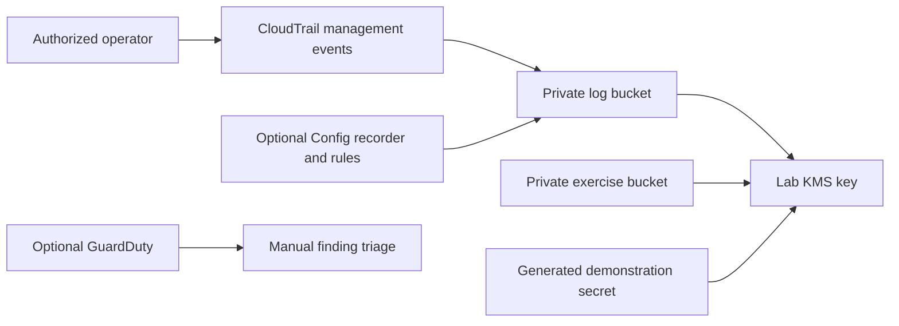

# Deploy and verify the AWS portion

Status on 25 October 2026: baseline deployed; the Config update reached UPDATE_COMPLETE and its
recorder was explicitly started after channel creation. Current rule results are recorded in the evidence index.
Account S3 Block Public Access was saved separately and verified. Budget email remains inactive;
the owner handles MFA. The owner chose current project limits, with no advanced-feature upgrade.

## What the baseline creates

- A rotating customer-managed KMS key.
- Separate log and exercise-evidence S3 buckets, each with four Block Public Access flags, versioning,
  default SSE-KMS, bucket-owner-enforced ownership and a policy denying insecure transport.
- A management-event CloudTrail trail with encrypted delivery and digest generation.
- A generated demonstration secret. Its value is never an output or stored in the repository.
- Optional Config recording of **all S3 buckets in the deployment Region**, with two rules scoped to the
  exercise bucket. Config's standard service policy reads account configuration; this is not a least-privilege human role.
- Optional regional GuardDuty foundational detection; listed additional protection plans are disabled.

The default parameters leave Config and GuardDuty off and use a single-Region trail. This template neither
upgrades the account nor changes account-level S3 Block Public Access, existing human roles or MFA settings.
It has no event notification integration, automatic remediation, secret rotation or data-event logging.



## 1. Establish access and inspect existing resources

Use Python 3.12+, AWS CLI v2 and an authorized short-lived AWS profile. For the current IAM Identity Center
path, use the organization's supported SSO setup (`aws configure sso --profile lab`, then `aws sso login
--profile lab`). The owner enters authentication material in AWS. Do not create access keys just for this lab.
Other supported identities may use AWS CLI's `aws login`; do not assume that flow applies to Identity Center.

Run from the repository root in PowerShell. Keep these outputs private:

```powershell
$LabProfile = 'lab'
$LabRegion = 'ap-southeast-2'
$LabStack = 'aws-security-lab'
aws sts get-caller-identity --profile $LabProfile
aws cloudtrail describe-trails --include-shadow-trails --region $LabRegion --profile $LabProfile
aws configservice describe-configuration-recorders --region $LabRegion --profile $LabProfile
aws configservice describe-delivery-channels --region $LabRegion --profile $LabProfile
```

Verify the dedicated account ID yourself. Record existing trails to avoid duplicate management-event charges.
If Config already has a customer-managed recorder or delivery channel, leave EnableConfig=false and design
an integration with the existing setup; this stack is not an import or replacement workflow. In a supported
advanced environment, inspect `aws guardduty list-detectors` before considering EnableGuardDuty=true.
Do not create a second detector or modify an existing one through this template.

## 2. Review the cost and coverage

The $10 monthly target is **not a guaranteed estimate or cap**. Cost depends on usage, existing services,
Region, taxes and credits. Price the actual Sydney configuration using the official links below. The key and
secret have ongoing charges, as do storage and some requests. Config charges depend on configuration items
and evaluations; recording all S3 buckets includes pre-existing buckets. GuardDuty has usage-dependent costs.
Keep Config/GuardDuty off until their separate exercise is planned; do not run a scanner host in AWS for this lab.

S3 lifecycle rules expire current objects after 30 days and noncurrent versions after 30 noncurrent days.
This is a short-lived learning setup, not a production audit-retention policy. Preserve approved evidence elsewhere
before expiry. Stack deletion retains both buckets, the key and secret; **retained resources can keep charging**.

Current project mode cannot provide multi-Region or GuardDuty. Setting EnvironmentMode=Advanced only asserts
that a suitable environment already exists; it does not activate advanced features or bypass AWS restrictions.
Read Lesson 2 before changing this parameter.

## 3. Validate and prepare a change set

```powershell
python -m pip install -r requirements-dev.txt
cfn-lint infra/baseline.json infra/iam-auditor.json
python -m unittest discover -s tests -v
aws cloudformation validate-template --template-body file://infra/baseline.json --region $LabRegion --profile $LabProfile
aws cloudformation create-change-set --stack-name $LabStack --change-set-name baseline-review --change-set-type CREATE --template-body file://infra/baseline.json --parameters file://infra/parameters-project.json --capabilities CAPABILITY_IAM --region $LabRegion --profile $LabProfile
aws cloudformation wait change-set-create-complete --stack-name $LabStack --change-set-name baseline-review --region $LabRegion --profile $LabProfile
aws cloudformation describe-change-set --stack-name $LabStack --change-set-name baseline-review --region $LabRegion --profile $LabProfile
```

Review the account, Region, parameters, new resources, IAM changes and price estimate before executing.
CAPABILITY_IAM acknowledges the optional Config service role; it does not authorize an unreviewed access grant.
The following is the actual deployment step and starts billable resources:

```powershell
aws cloudformation execute-change-set --stack-name $LabStack --change-set-name baseline-review --region $LabRegion --profile $LabProfile
aws cloudformation wait stack-create-complete --stack-name $LabStack --region $LabRegion --profile $LabProfile
```

If creation fails, inspect stack events privately. Do not mark the lab deployed from a successful change-set
creation. Stop on AccessDenied and determine the effective boundary; do not attach AdministratorAccess as a guess.

When enabling Config, the template creates the recorder stopped (`StartedOnCreate=false`), then creates
its delivery channel. After a successful stack update, explicitly start it and verify recording and evaluations:

```powershell
aws cloudformation create-change-set --stack-name $LabStack --change-set-name config-review --change-set-type UPDATE --template-body file://infra/baseline.json --capabilities CAPABILITY_IAM --parameters ParameterKey=EnableConfig,ParameterValue=true ParameterKey=EnvironmentMode,UsePreviousValue=true ParameterKey=EnableGuardDuty,UsePreviousValue=true ParameterKey=MultiRegionTrail,UsePreviousValue=true --region $LabRegion --profile $LabProfile
aws cloudformation wait change-set-create-complete --stack-name $LabStack --change-set-name config-review --region $LabRegion --profile $LabProfile
aws cloudformation describe-change-set --stack-name $LabStack --change-set-name config-review --region $LabRegion --profile $LabProfile
```

After reviewing that Config-only addition, execute and wait for the stack update before starting recording:

```powershell
aws cloudformation execute-change-set --stack-name $LabStack --change-set-name config-review --region $LabRegion --profile $LabProfile
aws cloudformation wait stack-update-complete --stack-name $LabStack --region $LabRegion --profile $LabProfile
aws configservice start-configuration-recorder --configuration-recorder-name "$LabStack-recorder" --region $LabRegion --profile $LabProfile
```

The first live attempt stalled with a stopped recorder and no channel. It was rolled back; the explicit
startup order above completed successfully. Creating rules alone does not prove they have evaluated resources.

## 4. Run configuration verification

```powershell
$LabAccount = Read-Host 'Dedicated lab account ID'
python scripts/verify_live.py --stack $LabStack --region $LabRegion --profile $LabProfile --expected-account $LabAccount --output private-evidence/live-check-01.json
```

The script checks the account first and stops on a mismatch. It reads stack outputs, S3 configuration, account
Block Public Access, KMS rotation/state, trail delivery and selectors, and secret metadata. Enabled optional
services get corresponding checks. It never reads the secret value, changes a policy, creates a finding or sends mail.
AccessDenied is ERROR, missing delivery is FAIL, disabled optional services are SKIP. Zero exit status means
PASS_WITH_LIMITS for these checks, not a completed security assessment. An account-level BPA failure is an
actual gap to review separately; bucket flags do not silently fix it.

## 5. Exercise behavior and collect evidence

Get names/ARNs from stack outputs privately. Use a harmless text file and record UTC start/end times.
The behavior script creates one harmless exercise object and retrieves the demo secret into memory only:

```powershell
python scripts/verify_behavior.py --stack $LabStack --region $LabRegion --profile $LabProfile --expected-account $LabAccount --output private-evidence/behavior-check-01.json
```

It tests the current operator, not a restricted role, and leaves its object subject to the bucket lifecycle.

| Control | Exercise and pass criterion |
| --- | --- |
| S3 encryption | Upload the text file without encryption headers; `head-object` must show aws:kms and the lab key. Try explicit AES256 and another key: both must be denied. Specifying aws:kms without a key is also denied. |
| S3 access | Authorized operator can access the exercise object; anonymous access fails. Inspect account and bucket BPA separately. Never make the bucket public as a test. |
| Transport | Review both bucket policies' SecureTransport deny. Verify only against disposable lab data if testing an HTTP request; never send credentials over HTTP. |
| CloudTrail | Generate a benign management call such as `get-bucket-versioning`; find the matching event name, time and principal in the delivered log. Delivery may take time. A recent delivery timestamp alone is not event correlation. |
| Log integrity | After digest files arrive, run `aws cloudtrail validate-logs --trail-arn TRAIL_ARN --start-time START_UTC --end-time END_UTC --region REGION --profile PROFILE --verbose`. Confirm actual digest/log counts and results; zero files is not success. Save raw output privately. |
| Config | If enabled, confirm recorder delivery and a current evaluation for the exercise bucket in each rule. INSUFFICIENT_DATA or no results remains incomplete. Encryption rule checks encryption generally; the script and object test check the specific KMS key. |
| GuardDuty | In a supported environment only, generate a service sample finding through the console, label it Sample, explain triage and document a disposition. A sample is not an actual attack and detector enablement alone proves no response integration. |
| Secrets | An authorized test identity retrieves the generated value without logging it; the restricted auditor is denied. Record action/status only. DescribeSecret does not prove retrieval boundaries or rotation. |

The optional [IAM exercise](iam-exercise.md) provides the restricted auditor path. Keep raw CloudTrail records,
CLI output, resource identifiers and screenshots outside public Git. Publish reviewed summaries only.

## 6. Stop and clean up

Remove only this lab's stack after reviewing evidence retention. Optional services managed by the stack are
deleted with it; do not manually delete unrelated detectors, recorders or trails. Verify the final stack status
and inventory afterward, including rollback leftovers.

Buckets, key and secret are deliberately retained. Export required evidence, then separately review object
versions, delete markers and lifecycle behavior before deleting a bucket. Schedule secret/key deletion only
after confirming no retained data needs them, and document recovery windows. Never schedule key deletion
while retained encrypted evidence is still needed. Check billing again after cleanup; stopping an exercise does
not eliminate charges for retained resources. No destructive cleanup was executed for this project.

## Official references

- [IAM Identity Center CLI setup](https://docs.aws.amazon.com/cli/latest/userguide/cli-configure-sso.html)
- [CLI console-credential login limitations](https://docs.aws.amazon.com/cli/latest/userguide/cli-configure-sign-in.html)
- [CloudTrail KMS permissions](https://docs.aws.amazon.com/awscloudtrail/latest/userguide/create-kms-key-policy-for-cloudtrail.html)
- [Config KMS delivery](https://docs.aws.amazon.com/config/latest/developerguide/s3-kms-key-policy.html)
- [Config recorder lifecycle](https://docs.aws.amazon.com/AWSCloudFormation/latest/TemplateReference/aws-resource-config-configurationrecorder.html)
- [CloudTrail integrity validation](https://docs.aws.amazon.com/awscloudtrail/latest/userguide/cloudtrail-log-file-validation-cli.html)
- [KMS pricing](https://aws.amazon.com/kms/pricing/), [Secrets Manager pricing](https://aws.amazon.com/secrets-manager/pricing/), [Config pricing](https://aws.amazon.com/config/pricing/), [GuardDuty pricing](https://aws.amazon.com/guardduty/pricing/), [CloudTrail pricing](https://aws.amazon.com/cloudtrail/pricing/), [S3 pricing](https://aws.amazon.com/s3/pricing/)
